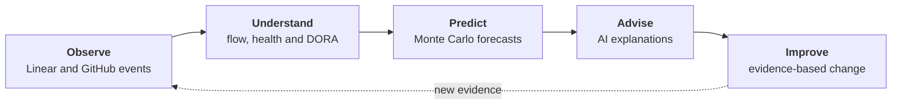

# Atlas

Atlas is a Delivery Intelligence Platform that transforms software delivery
events into actionable engineering intelligence.

It continuously observes software delivery, measures flow efficiency,
forecasts outcomes, and provides AI-powered guidance to help Engineering
Managers make better decisions.

Rather than replacing project management tools, Atlas sits on top of them
as an intelligence layer, helping engineering organizations understand how
work flows through their systems and how delivery performance impacts
business outcomes.

## Why Atlas?

Modern engineering teams generate enormous amounts of delivery data: issues
move across workflows, pull requests merge, deployments ship, projects slip
and deadlines move. Very few tools answer the questions engineering leaders
actually care about:

- Why is delivery slowing down?
- Where is the bottleneck?
- Which project is at risk?
- Which team needs attention today?
- What should I improve next?
- Are our process improvements actually working?
- How does engineering performance affect business outcomes?

Atlas exists to answer those questions.

## Philosophy

Most delivery dashboards stop at charts and leave the hard part to you:
what the charts mean, and what to do next. Atlas closes the loop. Each
step feeds the next, and each improvement you make becomes new evidence
for the next cycle.



- **Observe.** Atlas syncs work items from Linear, and pull requests and
  deployments from GitHub, into one vendor-neutral event model. Events
  never change, so every number traces back to the facts behind it.
- **Understand.** Flow metrics from Lean and Kanban, Delivery Health and
  DORA show where work waits, not only how much got done. The bottleneck
  gets a name.
- **Predict.** Monte Carlo simulations on your own history give completion
  dates as probabilities, not promises. Statistics forecast; AI does not
  guess.
- **Advise.** AI turns the numbers into explanations and prioritized
  recommendations, ready for your standup, retrospective or planning. It
  explains the numbers; it never invents them.
- **Improve.** Change a process, then let the same metrics tell you whether
  it worked. Decisions rest on evidence, not intuition.

## Main views

- **Executive**: health, flow, DORA and forecast accuracy for all teams on
  one page.
- **Teams** and **Projects**: metrics, charts, the bottleneck, aging work
  and a completion forecast.
- **Advisor** and **Meetings**: AI advice, and preparation for standups,
  retrospectives and planning.
- **Metric rules**: how Atlas calculates each metric, for the workspace or
  for one team.

## Quick start

Prerequisite: Docker with Compose.

1. Clone the repository and create the configuration file:

   ```bash
   git clone https://github.com/mcapanema/atlas.git
   cd atlas
   cp .env.example .env
   ```

2. Set `ATLAS_LINEAR_API_KEY` in `.env`.
3. Start Atlas with `make docker-up`.
4. Open http://localhost:8000.
5. Go to **Connectors** and click **Sync now**.

The [user guide](docs/GUIDE.md) tells how to run Atlas without Docker,
connect GitHub, turn on the AI, schedule syncs, and connect a chat client.

## Documentation

- [User guide](docs/GUIDE.md): the views, setup, sync, chat access and
  upgrade notes.
- [Vision](docs/VISION.md): the product vision and principles.
- [Architecture](docs/architecture/overview.md) and [ADRs](docs/adr/): how
  the code is organized, and why.
- [Contributing](CONTRIBUTING.md): CI, git hooks and Dependabot.
- [Product brief](PRODUCT.md): the design brief for the UI.
